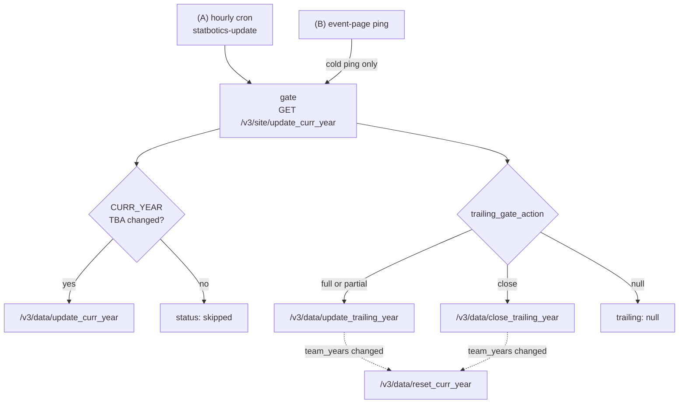

# Data refresh & EPA computation — how and when

**Authoritative reference for one question: how does the mirror recompute EPA and
re-ingest TBA data, and what triggers it?** This describes the `cph-staging`
branch, which is **what production runs** — not `cph-master` (the minimal
upstream-fix line), which lacks both the ping and the DuckDB/Parquet serving stack
(see [§7](#7-cph-master-vs-cph-staging)).

Verified live against `statbotics-staging` on 2026-07-17 (scheduler config, ping
endpoint, `/info`). The trailing-year sections (§1, §3, §5, §6) describe the
code as of 2026-11-24, before its first production run.

## 1. Design intent

- **While people are actively viewing an event, its match and event pages update
  within ~5 minutes** of TBA posting new schedules or results.
- **When no one is watching, the system refreshes once an hour or less.**
- **Both live years get these bounds.** A *live year* is `CURR_YEAR`, and the
  *trailing year* (`CURR_YEAR − 1`) while the *trailing window* is open: from
  the October rollover until **Dec 28 00:00 America/Los_Angeles** of the
  trailing year (Mon 2026-12-28 08:00 UTC for 2026). The previous season's
  offseason events run into December and must fill in exactly like an
  in-season event. The rule lives in
  [`backend/src/data/trailing.py`](../../../backend/src/data/trailing.py);
  the design is the
  [trailing-year refresh spec](../specs/2026-11-24-trailing-year-refresh-design.md).

Two triggers deliver this: a **read-triggered ping** (fast path, active use) and
an **hourly scheduler** (backstop, idle). Both call the *same* gate, which
probes the current year and then the trailing year. There is no third
mechanism — no TBA webhook, no frontend polling, no second scheduler. Refresh
*cadence* is the only lever, and it is set by infrastructure (Cloud Scheduler
frequency + how often pages are viewed), not by the code.

## 2. How EPA is computed — one engine

Every trigger runs the same function: `process_year()` in
[`backend/src/data/main.py`](../../../backend/src/data/main.py). Its steps, in order:

1. `process_year_tba` — fetch teams, events, matches from TBA (etag-cached).
2. `process_year_avg` — year score averages.
3. `process_year_wins` — win/loss/tie records.
4. `process_year_epa` — the model: `calc.py` **sorts every current-year match by
   time and replays each one** through the EPA model; `agg.py` rolls match EPA up
   to event and year; `metrics.py` computes normalized EPA.
5. Publish, by kind of year. **GCS is the only store** — the pipeline ends here.
   - `CURR_YEAR`: compressed site blobs plus current-year Parquet in a single
     `manifest.json` write, then the snapshot.
   - The trailing year while the trailing window is open: the **trailing
     publish** — its site blobs and Parquet as versioned `v2/` objects in one
     manifest write, then its snapshot. No hist blob is ever written for a
     live year.
   - Any other (past) year: its Parquet, then `publish_past_year`, which
     publishes the site blobs under the year's **year epoch**
     (`hist/{e}/…`, see [Past years: year epochs](#past-years-year-epochs)).

**EPA is a full-season replay every cycle — O(season), not incremental.** The
`partial` and `tba_partial` flags change only *how much prior state is loaded*
(a snapshot resume versus a cold rebuild) and the *TBA fetch scope*, never the
EPA math. A partial cycle and a full cycle produce
the same ratings from the same data. (An incremental O(new-matches) design was
proposed in the [2026-04-11 spec](../specs/2026-04-11-duckdb-static-files-rearchitecture-design.md)
and **rejected** — see that file's superseded banner.)

**Offseason freeze.** Offseason matches (`EventType.OFFSEASON`: TBA type 99, year
≥ 2025, week 9) produce predictions but **never move EPA** — `template.py` sets
`skip_update = offseason_event or ...`. They are also excluded from W-L records
and noteworthy leaderboards. `2026isrtp` is overridden to `DISTRICT` via
`EVENT_TYPE_OVERRIDES` and *does* update EPA. So a recompute triggered for an
offseason event refreshes that event's schedule, scores, and predictions while
leaving every rating unchanged.

## 3. When it runs — two automatic triggers, one gate

Both automatic triggers call the **same gate**,
`GET /v3/site/update_curr_year`. It probes the current year, then the
trailing year, and schedules each heavy cycle as its own background
self-call:

The current-year branch is unchanged: on a TBA change it backgrounds
`update_curr_year(partial=True, tba_partial=True)`, a full-season EPA replay
plus the GCS/Parquet publish. The response's `status` is `skipped`,
`backgrounded`, or `skipped` with `reason: snapshot-unreadable`. The
trailing branch adds a `trailing` field to every gate response — `"full"`,
`"partial"`, `"close"` or `null` — and is described under
[(C) The trailing year](#c-the-trailing-year--trailing-cycles).

### (A) Hourly scheduler — the idle backstop

Cloud Scheduler job `statbotics-update`, cron `0 * * * *`, hits
`GET /v3/site/update_curr_year` (attempt deadline 1800s). This is the correctness
backstop: even with no viewers, every live event refreshes within the hour.
(Companion job `statbotics-gc`, daily 04:30 UTC, garbage-collects unreferenced
blobs — it does not touch EPA.)

### (B) Read-triggered ping — the fast path (added in fork PR #13)

The frontend event page ([`frontend/src/pages/event/[event_id].tsx`](../../../frontend/src/pages/event/[event_id].tsx))
fires `GET /v3/site/ping/event/{key}` fire-and-forget, **on page view**, only for
an **event of a live year inside its event date window** (`start − 1 day … end
+ grace`). The frontend learns the live years from `isLiveYear(year)` in
[`frontend/src/api/storage.tsx`](../../../frontend/src/api/storage.tsx):
`CURR_YEAR`, or the manifest's `trailing_year`. The frontend has no date logic;
the backend owns the trailing window. There is no polling — one fetch per view.

The endpoint ([`backend/src/data/router.py`](../../../backend/src/data/router.py))
accepts keys of `CURR_YEAR` always and of the trailing year only while the
trailing window is open. It is pure in-process memory on the hot path:
validate the key regex, check two
module globals (`_ping_last_probe`, `_ping_inflight`); if a probe is in flight or
fewer than 300s have elapsed, return `204` and do nothing. Otherwise flip the
globals, schedule the probe, return `202`. A cold ping self-calls the **same**
`GET /v3/site/update_curr_year` gate as the cron.

Effect: while an event is being viewed, its pages refresh at most once per 5
minutes; when the last viewer leaves, the cron takes over. This buys sub-hourly
freshness during active use **without** running an expensive full-season replay
every few minutes around the clock.

### The shared gate

`check_year_partial` ([`backend/src/data/tba.py`](../../../backend/src/data/tba.py))
does a cheap TBA check and returns a boolean — it fetches nothing into the DB
and computes no EPA. It checks the `{year}/events` list etag first, then, for each
non-completed event inside its event date window, the `/matches`, `/rankings`, and
`/alliances` etags. Finally it sweeps **dropped offseason candidates**: type-99
events on TBA that the quality filters kept out of the mirror, currently inside
their event date window, get their roster/schedule probed with **unconditional** GETs
(TBA etags are not content fingerprints — the 2026wvrox incident; see
`backend/CLAUDE.md` → offseason filters gotcha), and the gate escalates when one
would now pass the filters. If nothing changed, the gate returns `{"skipped"}`
and no recompute happens — so a ping (or cron tick) over unchanged TBA data is
nearly free. Only a real change escalates to `GET /v3/data/update_curr_year`,
the heavy `process_year` cycle.

### (C) The trailing year — trailing cycles

After the current-year probe the gate always evaluates
`trailing_gate_action()` (`router.py`), including when the current-year
probe skipped. A failure there logs `TRAILING GATE: probe failed (…)` and
yields `trailing: null`; the gate never 500s. The action:

| `trailing` | When | Background self-call |
|---|---|---|
| `"full"` | Window open and the manifest's `trailing_year` is not the trailing year (the **bootstrap**, the first full trailing cycle of a rollover), or the trailing snapshot is unreadable | `GET /v3/data/update_trailing_year?full=1` |
| `"partial"` | Window open, marker set, and `check_year_partial(trailing year, …)` sees new TBA data (same checks as the shared gate) | `GET /v3/data/update_trailing_year?full=0` |
| `"close"` | Window closed and `close_would_act` holds: the manifest still sets `trailing_year` or holds a non-Parquet year key of the trailing year | `GET /v3/data/close_trailing_year` |
| `null` | Otherwise (nothing new, or window closed and window close is done), or the probe failed | none |

The bootstrap is decided by the manifest's `trailing_year` marker, not by the
snapshot: the snapshot left over from when the trailing year was current
reads fine and must not be trusted.

A **trailing cycle** (`update_trailing_year` in
[`backend/src/data/main.py`](../../../backend/src/data/main.py)) runs
`process_year` for the trailing year with current-year (live-year)
semantics: an event with no matches is Upcoming, one with matches but not
finished is Ongoing, and both stay in `events/Y`. A full trailing cycle
fetches TBA fresh (`cache=False`); a partial one resumes from the trailing
snapshot (and escalates to full if it is unreadable). The cycle then:

1. runs the **trailing publish**: site blobs and Parquet as versioned `v2/`
   objects in one manifest write; unchanged paths upload nothing. The
   manifest write re-checks the window and aborts if it closed meanwhile;
2. writes the trailing snapshot (manifest first, snapshot last);
3. on a full cycle, removes the year's year keys the trailing publish did not
   render (Parquet stays) and stamps `trailing_year` in one manifest write;
4. writes `trailing/status.json` at start and end, and prints
   `TRAILING {year} CYCLE COMPLETE full={0|1} secs={n}`;
5. if the trailing year's `parquet/{Y}/team_years` digest changed, chains a
   full current-year re-render plus `refresh_teams` (team pages embed every
   season's team_years). From the endpoint this is a **separate HTTP
   request**, `GET /v3/data/reset_curr_year`, sent after the pipeline lock
   is released. From a job driver (`reprocess_year` of the live trailing
   year) it runs inline (`chain="inline"`) before the driver returns.

The daily TBA sweep skips the trailing year while the window is open
(`normalize_cursor`), so nothing but trailing cycles writes it.

### Window close

On the first gate tick at or after Dec 28 00:00 PT the gate answers
`trailing: "close"` and self-calls `GET /v3/data/close_trailing_year`.
**Window close** (`close_trailing_year`) retires the trailing year into an
ordinary past year. It is stateless and rerunnable: it acts only while
`close_would_act` holds, so a run that dies is completed by the next tick.

1. A final full cycle with fresh TBA data, with **past-year** semantics (the
   window is closed, so the year is no longer live): the year is computed
   the way the sweep will later compute it, so the next sweep visit does not
   advance its year epoch spuriously. An event that never posted a match
   becomes Invalid (dropped from `events/Y`); an Ongoing event without elims
   becomes Completed.
2. Its Parquet, then `publish_past_year`: the site blobs move to a new year
   epoch on any change, and the year's non-Parquet manifest entries are
   removed.
3. One manifest write that sets `trailing_year: null`.
4. Prints `TRAILING {year} CLOSE {not_needed|closed|error} secs={n}` and
   chains the current-year re-render if the team_years digest changed.

### Past years: year epochs

A past year's site blobs are served from `hist/{e}/{path}`, where `e` is its
**year epoch**: `max(hist_epochs[year] ?? 0, hist_epoch)` from the manifest
(the frontend's `resolveHistEpoch`, the backend's `effective_hist_epoch`;
both use one year-from-path rule checked against shared test vectors). A
`manifest.blobs` entry still outranks `hist/`. Every past-year reprocess —
the daily sweep, `make reprocess-year`, window close, `reset_all_years` —
calls `publish_past_year`, which compares the rendered bytes with the
objects under `e` (per-path MD5) and prints
`YEAR EPOCH {year} {outcome} epoch={e}`:

- `unchanged` — every page already matches; nothing is written;
- `gap_filled` — the year has no objects under `e` (a cold year); all are
  written under `e`;
- `advanced` — some page is missing or differs; all are written under `e + 1`
  and then `hist_epochs[year] = e + 1` is set in one manifest write, so
  readers switch atomically and a past-year page can never stay stale.

`publish_past_year` refuses a live year. Hist objects are immutable and cached
for a year, which is why a change moves the whole year to a new epoch rather
than overwriting in place.

## 4. New events are ingested automatically

A genuinely new event appearing on TBA changes the `{year}/events` list etag.
`check_year_partial`'s first check catches that (`if new_etag != prev_etag: return
True # If any new events`), and the partial `process_year` re-fetches the events
list and upserts the new event, then pulls its matches if today falls in the
event window. An offseason event that was on TBA but **dropped by the quality
filters** (empty roster) re-enters through the gate's dropped-candidate sweep
once its roster fills and its event date window opens — its probes are refetched
unconditionally, never trusting a 304. **The hourly cron picks up new and
late-filling offseason events on its own** — no manual step required. The
same holds for the trailing year while the trailing window is open: the
gate's trailing probe runs the same `check_year_partial` on the trailing
year's events list and events, and a new trailing-year event appears in
`events/Y` with live-year statuses. After a rollover the trailing year needs
no manual step either: the gate's first tick runs the bootstrap.

The one exception is a **post-deploy backfill**: if you ship new ingest logic for
events that were *already on TBA* before the deploy, their etags are unchanged, so
the gate sees nothing new. Run `make reprocess-curr-year` **once** after such a
deploy to force a fresh full ingest. This is a deploy-time action, not steady
state — see [DEPLOY.md §3](deploy/DEPLOY.md).

## 5. Manual / operator triggers

Heavy recomputes are operator-run via the [Makefile](deploy/Makefile), never
automatic:

| Command | Endpoint | Effect |
|---|---|---|
| `make reprocess-curr-year` | `/v3/data/reset_curr_year` | Full current-year recompute, fresh TBA fetch, **no etag gate**. Picks up events already on TBA. ~4–6 min. |
| `make reprocess-year YEAR=` | Cloud Run job | One past year via `reprocess_year()`: `process_year(partial=False)` + Parquet + `publish_past_year` (year epoch) + chained current-year re-render. For the trailing year while the trailing window is open it runs a full trailing cycle instead, chain inline. |
| `make update-curr-year` | `/v3/site/update_curr_year` | Same cheap gated path as the hourly cron (manual poke). The JSON response carries `trailing`. |
| curl (no make target) | `/v3/data/update_trailing_year?full=1` | One trailing cycle by hand (`full=0` resumes from the snapshot). Answers `{"status": "busy"}` without waiting when the pipeline lock is held, `skipped` when the window is closed. Normally the gate does this. |
| curl (no make target) | `/v3/data/close_trailing_year` | Window close by hand: `not_needed` while the window is open or once done, else `closed`. Normally the gate does this. |
| `make verify-trailing YEAR= EVENT=` | read-only GETs | Prints `trailing_year`, `hist_epochs`, the year's non-Parquet year keys; resolves `events/Y` and `event/EVENT` as the frontend does and compares with the API. Non-zero exit on disagreement, a missing event, or a differing `EXPECT_TEAMS` / `EXPECT_MATCHES`. |
| `make info` | `/info` | `TRAILING_YEAR`, `TRAILING_WINDOW_OPEN`, `TRAILING_STATUS` (`trailing/status.json`), `HIST_EPOCHS`, `HIST_EPOCH_SHADOWED`, `MANIFEST_CONFLICTS`. |
| full history | `reset_all_years` | Rebuild 2002→present. See [historical-backfill.md](../deliverables/historical-backfill.md). |

## 6. Caveats and interactions

- **The ping cooldown is per-process, global, in-memory.** It is correct only
  because the data service runs a **single** gunicorn worker / instance. On
  multi-instance serving the "one probe per 5 min" bound multiplies per process.
  The state resets to "probe on next ping" at every redeploy.
- **The cooldown is global across events, not per-event.** One probe covers all
  events inside their event date windows at once, in both live years (the gate
  checks them all), so viewing any live event refreshes every live event. The
  [2026-07-16 spec §7](../specs/2026-07-16-offseason-events-design.md)
  first designed a *per-event* targeted refresh; the shipped code took that spec's
  own documented fallback — a global cooldown in front of the existing full cycle.
- **Overlapping cycles: the pipeline lock and the manifest precondition.**
  Cron and ping still call the gate independently. Within one process the
  heavy pipelines serialise on `PIPELINE_LOCK`
  ([`backend/src/data/pipeline_lock.py`](../../../backend/src/data/pipeline_lock.py)),
  taken non-blocking: a trailing endpoint answers `{"status": "busy"}`, and the
  current-year cycle, the sweep and `refresh_teams` skip and print
  `PIPELINE BUSY: skipped <name>`. A skipped cycle is caught up by the next
  gate tick. Across processes (two Cloud Run instances, a reprocess job)
  every `manifest.json` write goes through `update_manifest` with the
  **manifest precondition** (`if_generation_match` on the generation read),
  re-applying its own change on a 412 up to 5 times before failing into
  `/info` `MANIFEST_CONFLICTS`; and a manifest read error aborts the writer
  rather than planning from an empty manifest. So two writers can overlap,
  but neither erases the other's entries.
- **The trailing window ends on a fixed instant.** Dec 28 00:00
  America/Los_Angeles, a code rule, not a per-year constant. A trailing
  publish that commits after that instant aborts; window close then retires
  the year on the next gate tick.
- **Cadence lives in infrastructure, not git.** Upstream statbotics.io catches
  matches within minutes by running this same probe at a high scheduler frequency
  in-season. The mirror stays hourly and leans on the ping instead.

## 7. `cph-master` vs `cph-staging`

`cph-master` (the minimal upstream-fix line) describes an **older architecture**:
CockroachDB, three separate App Engine services, no ping. **Production runs
`cph-staging`**: no database at all — DuckDB-over-Parquet serving in one Cloud
Run container, the ping, the offseason freeze, trailing cycles with window
close, and year epochs (none of which `cph-master` has). When reasoning
about live behavior, read `cph-staging`. See [STAGING.md](STAGING.md) and [DEPLOY.md](deploy/DEPLOY.md).
